# Virement Portal

**IFAMS Virement** is EPF's (Employees Provident Fund, Malaysia) internal budget-transfer request-and-approval portal. It lets staff raise **Supplement**, **Return**, and **Transfer (Virement)** budget requests, routes each one through a multi-level approval chain based on organisational rules (department, branch, region, GL grouping, functional department, and amount), and posts the approved result into SAP S/4HANA as a budget document.

## What it does

- **Supplement** — request additional budget for a cost centre / WBS element.
- **Return** — hand budget back, either zeroed out ("Budget Zerorise") or returned to a central fund.
- **Transfer (Virement)** — move budget from one cost centre/GL account to another within the organisation.

Approval routing for Transfer (Non-Project) requests is rule-driven: the system classifies each request against a priority-ordered set of scenarios (matching functional department, GL group, department, branch, or region) and resolves the correct approver(s) from an admin-maintained Approver Matrix — including parallel, per-cost-centre approvers when a transfer spans multiple cost centres. Supplement and Return requests use a flat amount-tiered rule. Once every level approves, the request posts automatically to S/4 via SAP CPI.

## Tech stack

| Layer | Technology |
|---|---|
| Backend | SAP Cloud Application Programming Model (CAP), Node.js |
| Frontend | SAP Fiori Elements (OData V4), List Report + Object Page |
| Platform | SAP Business Technology Platform, Cloud Foundry |
| Database | SAP HANA (HDI container) |
| Auth | XSUAA (role collections) + SAP Identity Authentication Service (IAS, SCIM user-directory lookup only) |
| Workflow | SAP Build Process Automation |
| Integration | SAP Integration Suite (CPI), on-premise S/4HANA via Cloud Connector |
| Attachments | SAP Document Management Service (via `@cap-js/sdm`) |

## Getting started

```bash
npm install
cds watch
```

For local development, `package.json` provides mocked users for the `development` profile — no live XSUAA/IAS binding is required.

## Deploying

```bash
mbt build
cf deploy mta_archives/virement_1.0.0.mtar
```

Deployment provisions the CAP service, the Fiori app, and the HANA database. See §12 below for build/deploy detail, and §11 for the checks worth running before you build.

---

# Technical Handover

A working reference for anyone picking up this codebase — what each part of the system does, and exactly which file to open when you need to change it.

## Where do I change X? (quick index)

| Task | Go to |
|---|---|
| A request went to the wrong approver / wrong level / nobody | Follow the plain-language checklist in [§4 — Debugging a wrong approver](#debugging-a-wrong-approver--step-by-step) |
| Understand the tables, every field, and how they link | The ER diagram and field reference in [§3](#3-data-model) |
| Debug the CAP backend (logs, breakpoints, API calls, database) | [§11 — Debugging the backend](#debugging-the-backend-cap-service) |
| Add or adjust a submission validation | `srv/code/requests-before-create-logic.js` — one function per rule, see [§5](#5-submission--approval-lifecycle) |
| Change who approves a Virement request, or at what amount | `srv/code/utils/virement-scenario.js` (Non-Project scenarios) and `utils/approver-routing.js` (Supplement/Return bands), see [§4](#4-approval-routing-engine) |
| Add a new item-list field derived from Cost Centre / GL Account / Material | `srv/code/utils/*-lookup.js` + wire into `requestitems-drafts-before-create/update-logic.js`, see [§3](#3-data-model) |
| Fix or extend the S/4 posting (FMBB) payload | `srv/code/post-to-s4-logic.js` — `buildPayloads`/`buildHeader`, see [§6](#6-s4--earmarked-funds-integration) |
| A button/field silently doesn't respect a condition | Check `${...}` vs `%{...}` first — see the gotcha in [§11](#11-known-gotchas--hard-won-lessons) before anything else |
| Add a new admin-maintained master-data table (a new "Grouping") | Copy the GLGrouping five-file pattern, see [§10](#10-master-data-maintenance-pattern) |
| Change what SAP Build Process Automation receives at workflow start | `srv/code/utils/workflow-utils.js` — `startApprovalWorkflow` context, see [§7](#7-sap-build-workflow-integration) |
| Add a new role/permission check | Declarative: `srv/service.cds` `@requires`. Conditional-in-code: `srv/code/utils/role-check.js`'s `hasRole(user, roleName)` against a BTP Cockpit role collection, see [§8](#8-authorization-model) |
| A Fiori Elements table column, hide/disable rule, or item order | `app/virement.zui_pps_virement/annotations.cds` — 5 `UI.LineItem` qualifiers, see [§9](#9-fiori-elements-app-structure) |
| Deploy a change | `mbt build` then `cf deploy mta_archives/virement_1.0.0.mtar`, see [§12](#12-build--deploy-process) |
| Change a BTP destination name or the BPA workflow definition/environment ID without a redeploy | **System Configuration** admin page, see [§13](#13-admin-configuration-pages-email--system-configuration) |
| Edit an approval-notification email's subject/body | **Email Configuration** admin page, see [§13](#13-admin-configuration-pages-email--system-configuration) |

## 1. Program overview

There are three request types, set once at creation and immutable after (`db/schema.cds`, `RequestTypeCode` enum):

| Code | Type | Meaning |
|---|---|---|
| `S` | Supplement | Additional budget requested for a cost centre / WBS — increases available budget. |
| `R` | Return | Budget handed back — either zeroed out (**Zerorise**) or returned to a fixed central fund cost centre. |
| `T` | Transfer / Virement | Moves budget from one cost centre + GL account (transfer-out) to another (transfer-in), within the organisation. |

Two more classifications shape almost everything downstream:

- **Budget Type** — `Project` (`P`) or `Non-Project` (`N`). Project-budget requests are capped at **RM 5,000,000** total (Transfer-out or Supplement amount), and Project + Supplement requires a WBS element on every item.
- **Return Category** — Return-only. `Z` (Budget Zerorise) vs `C` (Budget Return to Central Fund, cost centre `100050500`). A Project-budget Return is *always* forced to Zerorise (Central Fund doesn't apply to Project budgets); raising a Zerorise return additionally requires the `BUDGET_ZERORISE` role, restricted to the BCM team.

**Transfer + Non-Project** gets the full business-rule-driven approval routing (§4); **Transfer + Project** is CAP-owned too, but deliberately simpler — a single level, Head of Transfer-out Cost Center per line, with no Level 2/3; **Return + Project** is also single-level (Head of JKEW, no amount tiering); every other combination uses the flat amount-tiered rule.

## 2. Architecture & deployment topology

Defined end-to-end in `mta.yaml` — 6 modules, 9 bound resources.

### Modules

| Module | Type | Role |
|---|---|---|
| `virement-virement.zuippsvirement` | html5 | The Fiori Elements UI5 app (`app/virement.zui_pps_virement`) |
| `virement-db-deployer` | hdb | Deploys CDS-generated HDI artifacts to HANA |
| `virement-srv` | nodejs | The CAP backend itself — single OData service `ZSVC_PPS_VIREMENT` |
| `virement-aux-destinations` | content | Creates 4 subaccount destinations (UAA, app-srv, HTML5-repo, and the API source SAP Build calls) |
| `virement-launchpad` | html5 | Separate launchpad shell app |
| `virement-aux-ui-deployer` | content | Pushes both zipped HTML5 apps into the HTML5 Apps Repo |

### Bound services

| Service | Used for |
|---|---|
| `virement-service-uaa` (XSUAA) | Login/OAuth, role collections `REQUEST_APPROVE` / `ADMIN` |
| `virement-service-db` (HANA HDI) | Persistence |
| `virement-ias` (Identity) | SCIM user-directory lookup only (IAS department/section, §11) — X.509-bound to `virement-srv`. AMS/DCL policy-based authorization has been removed from this app (§8); this binding is not used for authorization. |
| `virement-dms` | Attachment storage (Document Management Service, via `@cap-js/sdm`) |
| `shared-connectivity` | Cloud Connector routing to on-prem S/4 |
| `virement-service-destination`, `virement-service-metadata`, `shared-logs` | Destination lookups, service metadata, log aggregation |

Three external systems are reached purely by *destination name* at runtime — none are declared anywhere in `mta.yaml` or `xs-security.json`; they live only as BTP subaccount destinations. Their names default to the values below (hardcoded as fallbacks in each calling module) but are overridable per-subaccount from the **System Configuration** admin page — see §13 — without a redeploy:

- `QA1-800-S4HANA` (`S4_DESTINATION_NAME`) — on-prem S/4, via Cloud Connector, for the live value helps (Cost Centre, GL Account, Material Group, WBS) and the custom Email OData service
- `CPI` (`CPI_DESTINATION_NAME`) — the integration flow that fronts `ZFM_FI_FMBB_UPLOAD`, the Earmarked Funds creation/status API, and `Z_KFM_EF_COMPLETE` (Earmarked Funds completion)
- `sap_process_automation_service` (`BPA_DESTINATION_NAME`) — SAP Build Process Automation's REST API

> If a value-help or posting call starts failing with a connection error rather than a business error, check the destination configuration in BTP Cockpit first, then the current value on the System Configuration page — it will not be visible anywhere else in this codebase.

## 3. Data model

Everything lives in one file: `db/schema.cds` (namespace `ZDB_PPS_VIREMENT`).

### Requests (header)

Key fields: `requestNumber`, `requestType` (immutable after create), `budgetType`, `returnCategory`, `status` (Draft/Rejected/PendingApproval/Completed), `currentApprovalLevel`, the four `*Amount`/`*DocNumber` pairs (tracked independently per type, never summed), `earmarkedFundsDocNumber`, `workflowInstanceId`/`workflowStatus`/`workflowError`.

### RequestItems (line items)

Beyond the user-entered fields (`costCentre`, `glAccount`, `material`, `wbs`, amounts, `description`), nine fields are **system-derived and read-only** — resolved server-side the moment their source field changes, never left to client value-help write-back:

| Field | Derived from | Source |
|---|---|---|
| `costCentreDescription` | `costCentre` | Live S/4 Cost Centre search help |
| `department` | `costCentre` | `DepartmentGrouping` |
| `region` / `branch` | `costCentre` | `RegionBranchGrouping` |
| `buildingName` | `costCentre` | `BuildingGrouping` |
| `glAccountName` | `glAccount` | Live S/4 GL Account search help |
| `glGroup` | `glAccount` | `GLGrouping` |
| `assetType` | `glAccount` | `GLGrouping` — hides Asset Status when `NON ASSET` |
| `functionalDepartment` | `glAccount` | `FunctionalDepartmentGrouping` (matched against a multi-value list) |
| `materialGroupDescription` | `material` | Live S/4 Material Group search help |
| `wbsDescription` | `wbs` | Live S/4 WBS Element search help (`WBSElementVH`) |
| `responsibleCostCentre` | `wbs` | Same WBS Element search help — deliberately kept separate from `costCentre` (see below) |

All are populated in `srv/code/requestitems-drafts-before-create-logic.js` and `requestitems-drafts-before-update-logic.js`, calling `srv/code/utils/*-lookup.js` helper modules — one lookup module per field. **This is the pattern to copy for any new derived item field.**

`responsibleCostCentre` is not shown in any `UI.LineItem` by default (available via column personalization only) and is never read by the Department/Region/Branch cascade above — that cascade is a Non-Project (GL-based) concept. It exists solely to feed the Project Virement approval routing (§4): the Head of Transfer-out Cost Center role is resolved against it, via `ApproverMatrix.departmentBranch`, exactly like `costCentre` already does for Non-Project. A Project item's own `costCentre` is intentionally left empty.

### Master-data ("Grouping") entities

All admin-maintained, `cuid, managed`, explicitly "not sourced from S/4."

| Entity | Maps | Feeds into |
|---|---|---|
| `DepartmentGrouping` | Cost Centre → Department | Item `department`; "Same Department" routing |
| `RegionBranchGrouping` | Cost Centre → Region/State/Branch | Item `region`/`branch`; "Same Region/Branch" routing |
| `GLGrouping` | GL Account → GL Group, Asset Type | Item `glGroup`/`assetType`; "Same GL Group" routing |
| `FunctionalDepartmentGrouping` | GL Accounts list → Functional Department | Priority-0 and fallback "authorized functional department" routing |
| `BuildingGrouping` | Cost Centre → State/building | Item `buildingName`; also a routing input via a Functional Department Grouping row's **Building Grouping** flag (below) |
| `ApproverMatrix` | Role + scope → current approver email | Every approval lookup — see §4 |
| `ApproverDelegation` | Temporary cover for one `ApproverMatrix` row | Substituted live at lookup time, not retroactive to already-pending requests |

### Entity relationship diagram

Solid lines are **real links** (a foreign-key column or a CDS composition). Dotted lines are **soft links** — no foreign key exists; the app matches on a *value* (e.g. a cost centre number) at the moment it needs it. Grouping/master tables are always soft-linked, which is why a typo in one of them changes routing silently instead of raising a database error.

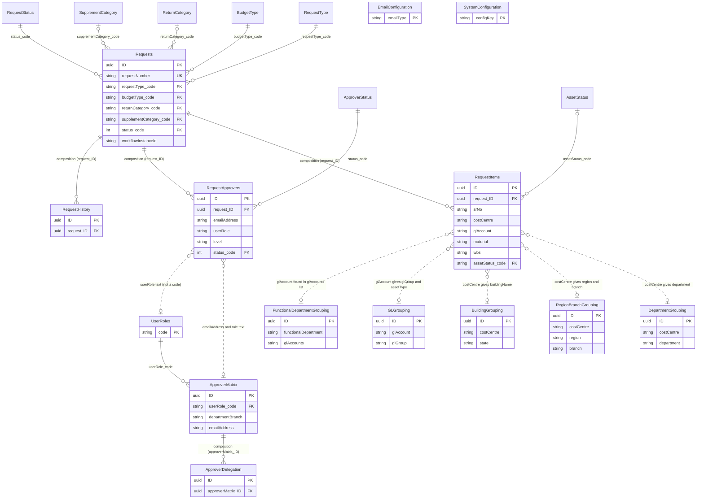

`EmailConfiguration` and `SystemConfiguration` stand alone — nothing links to them by key; code reads them by their key (`emailType` / `configKey`) when it needs a setting.

#### How the tables link — in plain words

| From | To | Linked by | Kind | What it means |
|---|---|---|---|---|
| `Requests` | `RequestItems` | `RequestItems.request_ID` | Composition (parent → children) | A request owns its line items. Delete/discard the request and its items go with it. |
| `Requests` | `RequestApprovers` | `RequestApprovers.request_ID` | Composition | One row per approver per level for that request. |
| `Requests` | `RequestHistory` | `RequestHistory.request_ID` | Composition | The audit trail of changes. |
| `ApproverMatrix` | `ApproverDelegation` | `ApproverDelegation.approverMatrix_ID` | Composition | Temporary cover for one approver. |
| `Requests` | the six code lists | `requestType_code`, `budgetType_code`, `returnCategory_code`, `supplementCategory_code`, `status_code` | Foreign key | Each request stores a short code; the code list gives its name. |
| `RequestApprovers` | `ApproverStatus` | `status_code` | Foreign key | Inactive / Rejected / Pending Approval / Completed. |
| `RequestItems` | `AssetStatus` | `assetStatus_code` | Foreign key | New / Addition / Replacement. |
| `ApproverMatrix` | `UserRoles` | `userRole_code` | Foreign key | Which role this person holds. |
| `RequestItems` | `DepartmentGrouping` | `costCentre` = `costCentre` | **Soft** (value match) | Fills the item's `department`. |
| `RequestItems` | `RegionBranchGrouping` | `costCentre` = `costCentre` | Soft | Fills `region` and `branch`. |
| `RequestItems` | `BuildingGrouping` | `costCentre` = `costCentre` | Soft | Fills `buildingName`. |
| `RequestItems` | `GLGrouping` | `glAccount` = `glAccount` | Soft | Fills `glGroup` and `assetType`. |
| `RequestItems` | `FunctionalDepartmentGrouping` | `glAccount` is one of the row's `glAccounts` list | Soft | Fills `functionalDepartment`; its three tick-boxes then steer routing (§4). |
| `RequestApprovers` | `ApproverMatrix` | `emailAddress` (and the role's name text) | Soft | `ApproverMatrix.PendingApprovals` is a **computed** association: every `RequestApprovers` row for that email with status Pending Approval. Nothing is stored. |
| `RequestApprovers` | `UserRoles` | `userRole` holds the role's **name text**, not its code | Soft | Descriptive text copied at assignment time. |
| `ApproverMatrix` | request item values | `departmentBranch` is matched against a cost centre, department, branch, region or functional department, depending on the role | Soft | This is how the routing rules pick *which person* holds a role for *this* request (§4). |
| `Requests` | SAP Build workflow log | `workflowInstanceId` | Live read, not stored | The `WorkflowLogs` facet is read from SAP Build Process Automation on demand. |

**Column naming:** a link field appears in the database as `<field>_<key>`, e.g. `requestType` → column `requestType_code`, `request` → `request_ID`. Tables are named `ZDB_PPS_VIREMENT_<ENTITY>` (e.g. `ZDB_PPS_VIREMENT_REQUESTS`).

### Field reference — every table

Every entity below also carries the standard fields from the aspects it uses:

- **`cuid`** — `ID` (UUID, the primary key, generated automatically).
- **`managed`** — `createdAt`, `modifiedAt` (timestamps) and `createdBy`, `modifiedBy` (user ids), filled in automatically.
- **`CodeList`** (code lists only) — `code` (the key), `name`, `descr`; each code list also gets a `_texts` table for translations.

"Read-only" means the server fills the field and the UI/API cannot write it. "Derived" means it is looked up from another field (see the derived-field table above).

#### Requests (the request header)

| Field | Type | Required / default | Meaning |
|---|---|---|---|
| `ID` | UUID | Key, generated | Internal id. |
| `requestNumber` | String(10) | Read-only, unique | Human-readable request number, generated at first submission (e.g. `N26000135`). |
| `requestType` | → `RequestType` (`requestType_code`) | Immutable after create | Supplement (S), Return (R) or Transfer/Virement (T). |
| `budgetType` | → `BudgetType` (`budgetType_code`) | Default `N` | Project (P) or Non-Project (N). |
| `returnCategory` | → `ReturnCategory` (`returnCategory_code`) | Optional | Return requests only: Zerorise (Z), Central Fund (C) or Half-Year Excess (H). |
| `supplementCategory` | → `SupplementCategory` (`supplementCategory_code`) | Optional | Supplement requests: Supplement (S) or Half-Year (H). |
| `transferCategory` | String(1) | Set at first submission, Virement only | `J` if the requestor holds a JKEW role, else `F` if a Functional role, else `P` / `N` from the budget type. It becomes the **first letter of the request number** for Virements (Return requests start with `R`, Supplements with `S`), e.g. `N26000135`. |
| `status` | → `RequestStatus` (`status_code`) | Default `0` (Draft) | Draft / Rejected / Pending Approval / Completed. |
| `currentApprovalLevel` | Integer | Optional | The approval level currently waiting for action. |
| `fiscalYear` | String(4) | Read-only, 4 digits | Fiscal year of the request. |
| `submissionPeriod` | Integer | Optional | Month of submission (1–12). |
| `submissionDate` | Date | Optional | Date submitted. |
| `submissionTime` | Time | Read-only | Time submitted. |
| `requestor` | String | Read-only | Requestor's email, snapshotted at submission. |
| `departmentSection` | String(500) | Read-only | Requestor's Department/Section, read from the IAS directory at submission. |
| `approvedBy` | String | Optional | Last approver (summary). |
| `supplementAmount` | Decimal(15,2) | Read-only, default 0 | Total supplement amount. |
| `returnAmount` | Decimal(15,2) | Read-only, default 0 | Total return amount. |
| `transferInAmount` | Decimal(15,2) | Read-only, default 0 | Total transfer-in amount. |
| `transferOutAmount` | Decimal(15,2) | Read-only, default 0 | Total transfer-out amount. |
| `aging` | Integer | Read-only, default 0 | Days since submission; stops counting once the request is Rejected or finished. |
| `supplementDocNumber` | String | Read-only | S/4 budget document number for a supplement posting. |
| `returnDocNumber` | String | Read-only | S/4 document number for a return posting. |
| `transferInDocNumber` | String | Read-only | S/4 document number, transfer-in side. |
| `transferOutDocNumber` | String | Read-only | S/4 document number, transfer-out side. |
| `earmarkedFundsDocNumber` | String | Read-only | S/4 Earmarked Funds (fund reservation) document, created at submit for Virements with a transfer-out amount. |
| `postingDate` | Date | Optional | Date posted to S/4. |
| `postingPeriod` | Integer | Optional | Month posted (1–12). |
| `reason` | String(500) | Optional | Requestor's reason. |
| `approverComment` | String(500) | Optional | Latest approver comment. |
| `requestLink` | String(1000) | Optional | Link back to the request. |
| `workflowInstanceId` | String | Optional | SAP Build Process Automation instance id. |
| `workflowStatus` | String | Optional | Last known workflow status (polled, not pushed). |
| `workflowError` | LargeString | Optional | Last workflow error text. |
| `RequestItems` | Composition of many `RequestItems` | — | The line items. |
| `RequestApprovers` | Composition of many `RequestApprovers` | — | The approvers. |
| `RequestHistory` | Composition of many `RequestHistory` | — | The change history. |

#### RequestItems (line items)

| Field | Type | Required / default | Meaning |
|---|---|---|---|
| `request` | → `Requests` (`request_ID`) | — | Parent request. |
| `srNo` | String(3) | Optional | Line number (001, 002 …). |
| `budgetTypeCode` | String(1) | Read-only | Copy of the parent's budget type, kept in sync by the server so the UI can show/hide Cost Centre/GL/Material vs WBS columns. |
| `costCentre` | String(10) | User-entered | Cost centre (Non-Project). |
| `costCentreDescription` | String(100) | Read-only, derived | From the live S/4 Cost Centre search help. |
| `department` | String(150) | Read-only, derived | From `DepartmentGrouping` via `costCentre`. |
| `region` | String(150) | Read-only, derived | From `RegionBranchGrouping` via `costCentre`. |
| `branch` | String(150) | Read-only, derived | From `RegionBranchGrouping` via `costCentre`. |
| `glAccount` | String | User-entered | GL account. |
| `glAccountName` | String(100) | Read-only, derived | From the live S/4 GL Account search help. |
| `glGroup` | String(100) | Read-only, derived | From `GLGrouping` via `glAccount`. |
| `assetType` | String(10) | Read-only, derived | From `GLGrouping`; `NON ASSET` hides Asset Status. |
| `functionalDepartment` | String(200) | Read-only, derived | From `FunctionalDepartmentGrouping` (GL found in its list). |
| `buildingName` | String(200) | Read-only, derived | From `BuildingGrouping` via `costCentre`. |
| `material` | String | User-entered | Material / commitment-item group. |
| `materialGroupDescription` | String(200) | Read-only, derived | From the live S/4 Material Group search help. |
| `wbs` | String | User-entered | WBS element (Project budget). |
| `wbsDescription` | String(40) | Read-only, derived | From the live S/4 WBS Element search help. |
| `responsibleCostCentre` | String(10) | Read-only, derived | The WBS's responsible cost centre; used only for Project Virement routing. |
| `assetStatus` | → `AssetStatus` (`assetStatus_code`) | Optional | New / Addition / Replacement. |
| `supplementAmount` | Decimal(15,2) | Default 0, range 0 – 9,999,999,999,999.99 | Supplement amount for this line. |
| `returnAmount` | Decimal(15,2) | Default 0, same range | Return amount for this line. |
| `transferInAmount` | Decimal(15,2) | Default 0, same range | Transfer-in amount for this line. |
| `transferOutAmount` | Decimal(15,2) | Default 0, same range | Transfer-out amount for this line. |
| `description` | String(500) | Optional | Line description (truncated to 50 characters when sent to S/4 Earmarked Funds). |

#### RequestApprovers (who must approve, per level)

| Field | Type | Required / default | Meaning |
|---|---|---|---|
| `request` | → `Requests` (`request_ID`) | — | Parent request. |
| `emailAddress` | String | — | The approver's email. |
| `userRole` | String | — | The role's **name text** (e.g. "Head of Department"), not its code. |
| `level` | String | — | `1`, `1A`–`1E` (parallel sub-levels), `2`, `3`. |
| `status` | → `ApproverStatus` (`status_code`) | Default `0` (Inactive) | Inactive / Rejected / Pending Approval / Completed. Empty on a draft preview. |
| `taskId` | String | Optional | SAP Build workflow task id. |
| `actionDate` | DateTime | Optional | When the approver acted. |
| `comment` | String(500) | Optional | The approver's comment. |

#### RequestHistory (audit trail)

| Field | Type | Meaning |
|---|---|---|
| `request` | → `Requests` (`request_ID`) | Parent request. |
| `date` | Date | Date of the change. |
| `time` | Time | Time of the change. |
| `changedBy` | String | Who made the change. |
| `changes` | String(500) | What changed. |

#### ApproverMatrix (who holds each role)

| Field | Type | Required / default | Meaning |
|---|---|---|---|
| `userRole` | → `UserRoles` (`userRole_code`) | Mandatory | The role. |
| `departmentBranch` | String(100) | Optional | The scope the person covers (a department, branch, cost centre, region or functional department). Blank for roles that are not scoped. |
| `emailAddress` | String(100) | Mandatory | Approver's email. |
| `name` | String(100) | Mandatory | Approver's name. |
| `isActive` | Boolean | Default `true` | A row is used for routing only while it is active **and** today falls within its start/end dates. |
| `startDate` | Date | Optional | First day the person holds the role. Blank = no start limit. |
| `endDate` | Date | Optional | Last day the person holds the role. Blank = no end limit. |
| `Delegations` | Composition of many `ApproverDelegation` | — | Planned cover for this person. |
| `PendingApprovals` | Association to many `RequestApprovers` (computed) | — | Every `RequestApprovers` row for this email currently Pending Approval. Computed at read time; not a stored column. |

#### ApproverDelegation (planned cover)

| Field | Type | Required | Meaning |
|---|---|---|---|
| `approverMatrix` | → `ApproverMatrix` (`approverMatrix_ID`) | — | The approver being covered. |
| `delegateEmail` | String(100) | Mandatory | Who covers. |
| `delegateName` | String(100) | Optional | Cover's name. |
| `startDate` | Date | Mandatory | First day of cover. |
| `endDate` | Date | Mandatory | Last day of cover. |

#### GLGrouping

| Field | Type | Required | Meaning |
|---|---|---|---|
| `expenditureGroup` | String(100) | Mandatory | The wider expenditure group above the GL group. |
| `glGroup` | String(100) | Mandatory | GL group (used for "Same / Different GL Group" routing). |
| `glAccount` | String(10) | Mandatory | GL account. |
| `glAccountDescription` | String(200) | Optional | GL account description. |
| `assetType` | String(10) | Optional | `ASSET` or `NON ASSET`. |
| `functional` | String(20) | Optional | Functional marker. |

#### DepartmentGrouping

| Field | Type | Required | Meaning |
|---|---|---|---|
| `department` | String(150) | Mandatory | Department name. |
| `costCentre` | String(10) | Mandatory | Cost centre that belongs to it. |
| `costCentreDescription` | String(200) | Optional | Cost centre description. |

#### RegionBranchGrouping

| Field | Type | Required | Meaning |
|---|---|---|---|
| `region` | String(150) | Mandatory | Region. |
| `state` | String(50) | Optional | State. |
| `branch` | String(150) | Mandatory | Branch. |
| `costCentre` | String(10) | Mandatory | Cost centre in that branch. |
| `costCentreDescription` | String(200) | Optional | Cost centre description. |

#### BuildingGrouping

| Field | Type | Required | Meaning |
|---|---|---|---|
| `state` | String(50) | Mandatory | State where the building is. |
| `costCentre` | String(10) | Mandatory | Cost centre of the building. |
| `costCentreDescription` | String(200) | Optional | Becomes the item's `buildingName`. |

#### FunctionalDepartmentGrouping

| Field | Type | Required / default | Meaning |
|---|---|---|---|
| `functionalDepartment` | String(200) | Mandatory | Functional department name. |
| `itemType` | String(500) | Optional | What kind of items it covers. |
| `glAccounts` | String(2000) | Optional | The GL accounts it covers — a multi-value list separated by new lines, commas, `/` or `&`. |
| `isBuildingGrouping` | Boolean | Default `false` | Ticked: a line that is a building cost centre counts as this department's own. |
| `isDepartment` | Boolean | Default `false` | Ticked: a line whose department equals this functional department counts as its own. |
| `isRegionAndBranch` | Boolean | Default `false` | Ticked: a line with both a region and a branch counts as its own. |
| `remarks` | String(1000) | Optional | Free-text notes. |

#### EmailConfiguration (one row per email type)

| Field | Type | Required / default | Meaning |
|---|---|---|---|
| `emailType` | String(20) | **Key**: `ToApprover`, `Approved` or `Rejected` | Which notification this row configures. Exactly one row per type; rows are edited, never created or deleted. |
| `subject` | String(500) | Optional | Email subject (supports placeholders such as `{{RequestNumber}}`). |
| `body` | LargeString | Optional | Email body, HTML with placeholders; `{{ItemsTable}}` is replaced by a system-built table. |
| `enabled` | Boolean | Default `true` | Switches this email on or off. |

#### SystemConfiguration (one row per setting)

| Field | Type | Required | Meaning |
|---|---|---|---|
| `configKey` | String(100) | **Key** | The setting's name (e.g. a destination name or workflow id). |
| `configValue` | String(500) | Optional | The value for this environment. |
| `description` | String(500) | Read-only | What the setting is for. |

Secrets (such as the IAS SCIM client id/secret) are deliberately **not** stored here — they stay as `cf set-env` variables.

#### Code lists and their values

| Code list | Key type | Values |
|---|---|---|
| `RequestType` | String(1) | `S` Supplement · `R` Return · `T` Transfer (Virement) |
| `RequestStatus` | Integer | `0` Draft · `1` Rejected · `2` Pending Approval · `3` Completed |
| `ApproverStatus` | Integer | `0` Inactive · `1` Rejected · `2` Pending Approval · `3` Completed |
| `BudgetType` | String(1) | `P` Project · `N` Non-Project |
| `ReturnCategory` | String(1) | `Z` Zerorise · `C` Central Fund · `H` Half-Year Excess |
| `SupplementCategory` | String(1) | `S` Supplement · `H` Half-Year |
| `AssetStatus` | String(3) | `001` New · `002` Addition · `003` Replacement |
| `UserRoles` | String(60) | `HOD_XFER_CC` Head of Transfer-out Cost Center · `HOD` Head of Department · `HOB` Head of Branch · `REG_DIR` Regional Director · `HOD_FUNC` Head of Functional Department · `HOD_JKEW` Head of JKEW · `JKEW_PG14` / `JKEW_PG19` / `JKEW_PG21` JKEW Officer PG14 / 19 / 21 and above · `JKEW_BCM` JKEW Officer (BCM) · `CEO_CFO` CEO/CFO |

> `db/data/ZDB_PPS_VIREMENT-RequestItemType.csv` is a leftover seed file: there is **no** `RequestItemType` entity in `db/schema.cds`, so it loads nothing. It can be deleted safely.

#### Entities that are *not* database tables

These exist only in the service layer (`srv/service.cds`); they are never stored.

| Entity / field | What it is |
|---|---|
| `Requests` extra fields: `isPendingApprover`, `isJKEW`, `isFunctional`, `isAdmin`, `isMyRequest`, `earmarkedFundsIsCompleted` | Virtual flags worked out per user/per read (e.g. "is the current user a pending approver of this request"). Never persisted. |
| `Requests.WorkflowLogs` → `WorkflowLogs` | Live workflow execution log read from SAP Build Process Automation: `logId`, `workflowInstanceId`, `timestamp`, `type`, `activityName`, `message`. |
| `RequestItems` extra fields: `isDepartment`, `isRegionAndBranch`, `isBuilding` | "Yes"/"No" display helpers calculated from `department`, `region`+`branch`, `buildingName`. |
| `CostCenters`, `GLAccounts`, `MaterialGroups`, `WBSElements` | Live S/4 value-help lists (cost centre / GL account / material group / WBS element with their names). |
| `RecentRequests`, `PendingApprovalCount`, `UserDetails` | Home-page helpers: recent requests, the "N approvals need your review" count, and the signed-in user's name and admin/approver/BCM flags. |

## 4. Approval routing engine

Three files, read together: `utils/virement-scenario.js` (Transfer/Non-Project only) → `utils/approver-routing.js` (branches by request type) → `utils/apply-approver-plan.js` (turns the plan into real `RequestApprovers` rows via `get-approvers-logic.js`).

### Non-Project Virement scenario priority (first match wins)

| # | Scenario | Level 1 | Level 2 |
|---|---|---|---|
| 0 | Functional Department Grouping match (all items share one FD; every Transfer In item satisfies a ticked flag — Department, Region & Branch, or Building; every Transfer Out item satisfies Department or Building) | `HOD_FUNC` | — |
| 1 | Different GL Group | `HOD_XFER_CC` × transfer-out line (lettered) | `HOD_JKEW` → L3 `CEO_CFO` |
| 2 | Same Department | `HOD` | — |
| 3 | Same Branch | `HOB` | — |
| 4 | Same Region, different Branch | `HOD_XFER_CC` × transfer-out line (lettered) | `REG_DIR` |
| 5 | Authorized Functional Department (loose) | `HOD_FUNC` | — |
| 6 | Fallback — relationship criteria not met | `HOD_XFER_CC` × transfer-out line (lettered) | Amount-tiered (below) |

Amount tiers (scenario 6, and identically for plain Supplement/Return): `<30,000 → JKEW_PG14` · `≤100,000 → JKEW_PG19` · `≤500,000 → JKEW_PG21` · `else → HOD_JKEW`.

### The "1A–1E" lettered mechanic

Whenever Level 1 is `HOD_XFER_CC`, it resolves **once per transfer-out line item**, in item order — `1A`, `1B`, ... up to `1E` (the enforced 1–5 Transfer-Out line cap), each scoped to that line's own `costCentre` via `ApproverMatrix.departmentBranch`. These are **independent parallel approvers**, not redundant alternates — `approve-reject-request.js` waits for every sibling letter to act before the request advances past Level 1 (see §5).

### Project Virement scenario (`classifyVirementProjectScenario`)

Deliberately much simpler than the Non-Project chain above: a Project item is identified by WBS Element alone, whose Responsible Cost Center is auto-derived into the dedicated `responsibleCostCentre` field (§3 — kept separate from `costCentre`, which stays empty for a Project item since the GL-based Department/Region cascade doesn't apply to WBS-based items). There is exactly one level — `HOD_XFER_CC` (Head of Transfer-out Cost Center), resolved once per transfer-out line item against `responsibleCostCentre` via `ApproverMatrix.departmentBranch`, same lettered `1A`–`1E` mechanic as Non-Project. No Level 2/3.

### Other request types (approver-routing.js)

- **Supplement** — fixed single level, role `JKEW_BCM`, no amount dependency.
- **Return, Non-Project** — single level, amount-tiered role (same 4 bands as above).
- **Return, Project** — single level, always `HOD_JKEW` — no amount tiering.

`getManagedLevels(requestType, budgetType)` returns the full universe of levels a combo could *ever* use (e.g. `["1","1A".."1E","2","3"]` for Transfer/Non-Project, `["1A".."1E"]` for Transfer/Project) so `applyApproverPlan` can wipe every stale level from an earlier classification, not just the ones the current plan happens to use — important when item edits mid-draft change which scenario applies.

> Two read-only helpers built on the same plan, both used at submission (§5): `previewApprovalPlanGaps` (any level resolving to zero current approvers — hard blocks) and `resolveApprovalPlanWithApprovers` (levels with actual resolved emails — used for the same-person conflict checks).

### Debugging a wrong approver — step by step

**The problem this section solves:** someone raised a Virement request and it went to the wrong approver (or to nobody). This guide shows how to find out why, in plain steps. You do **not** need to submit a real request to test — use a **draft** (see Step 1).

**How routing works, in one paragraph.** The app does not pick an approver by guessing. For each line in the request it looks up a few facts (which department the cost centre belongs to, which GL group the GL account is in, whether the cost centre is a building, and so on). It then goes down a fixed list of rules, from most specific to least specific, and uses the **first rule that fits**. If no specific rule fits, it falls to the last rule, which sends the request to JKEW. So a request landing at JKEW usually means *a more specific rule should have fitted but one of the facts was missing or different from what you expected.* Debugging = finding which fact.

#### Step 1 — Reproduce it on a draft (nothing is sent to anyone)

1. In the portal, click **Create Request** and choose **Virement** as the Request Type.

   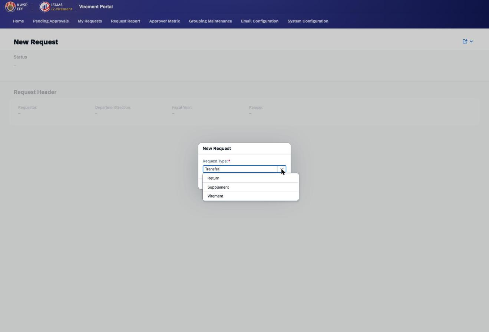

2. Add the same lines as the problem request (same cost centre, GL account, material, amounts). One line is "transfer out" (amount in *Transfer Out Amount*), the other is "transfer in" (amount in *Transfer In Amount*).

   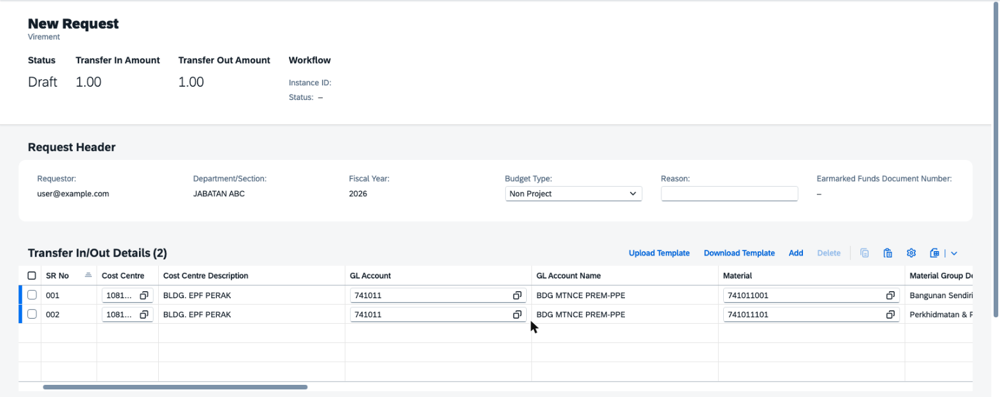

3. Scroll down to the **Approvers** table. It updates by itself every time you change a line, and it is only a preview — nobody is notified.
4. When finished, click **Discard Draft**.

Example of a **wrong result** (a request that should have gone to the Head of Functional Department but fell to the last-resort rule — two JKEW Officers at level 2). Taken on DEV before the building fix was deployed there:

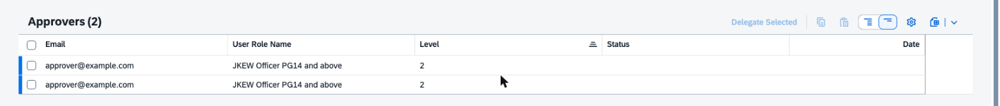

Look at who appears in the Approvers table. This tells you which rule fired:

| What you see in Approvers | Which rule fired (in plain words) |
|---|---|
| One approver, level 1, **Head of Functional Department** | The request belongs to one functional department (e.g. Property Management) |
| One approver, level 1, **Head of Department** or **Head of Branch** | Everything is inside the same department / branch / cost centre |
| Several level-1 approvers (1A, 1B…) **plus** a level 2 **JKEW Officer** or **Head of JKEW** | **The last-resort rule.** No specific rule fitted. This is the usual "wrong approver" symptom. |
| Level-1 approvers → level 2 **Head of JKEW** → level 3 **CEO/CFO** | The lines are in different GL groups |
| Level-1 approvers → level 2 **Regional Director** | Same region, different branches |
| Only a **JKEW Officer** or **Head of JKEW** at level 1 | Money is being taken out of the Central Fund (special rule) |
| Nobody | Either the request is incomplete (needs at least one "transfer out" and one "transfer in" line), or the role has nobody assigned (see Step 6) |

#### Step 2 — Look at the facts the app found for each line

The app fills these in by itself from the cost centre / GL account. They are hidden by default. To see them: in the line-item table click the **gear icon** (column settings) and tick **Department, Region, Branch, GL Group, Functional Department, Is Building, Building Name**.

If any of these is **empty** or **different from what you expected**, that is almost always the cause. (Is Building = Yes just means the cost centre was found in the Building list.)

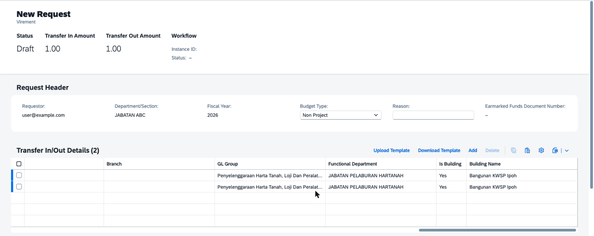

In this example the cost centre is a building, so *Department*, *Region* and *Branch* are all empty (those columns sit just to the left of the ones shown) and *Is Building* is Yes. That combination is exactly what the building fix handles. Also notice *Functional Department* — it came back as JABATAN PELABURAN HARTANAH, not JABATAN PENGURUSAN HARTA (see the "same GL under two departments" warning in Step 3).

#### Step 3 — Fix or check the lists these facts come from

These facts come from lists that admins maintain under **Grouping Maintenance** in the portal:

| If this fact is wrong or empty | Check this list |
|---|---|
| Department | Department Grouping (cost centre → department) |
| Region / Branch | Region & Branch Grouping (cost centre → region, branch) |
| GL Group | GL Grouping (GL account → group) |
| Functional Department | Functional Department Grouping (GL account → functional department) |
| Building Name | Building Grouping (cost centre → building) |

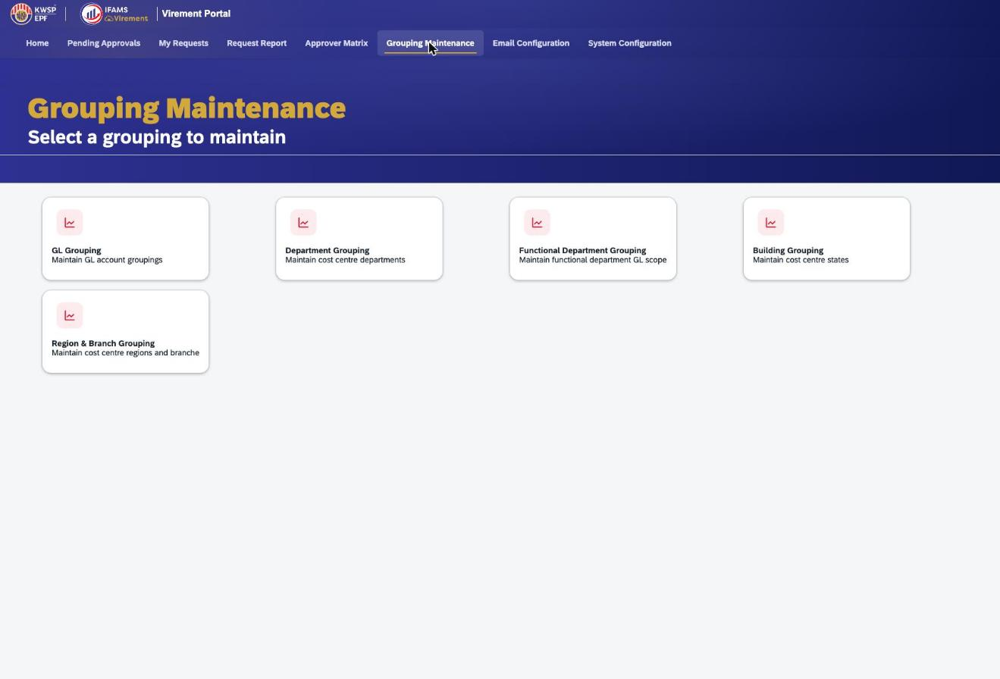

Open **Functional Department Grouping** and search for the GL account. This is what it looks like for GL 741011 (DEV data):

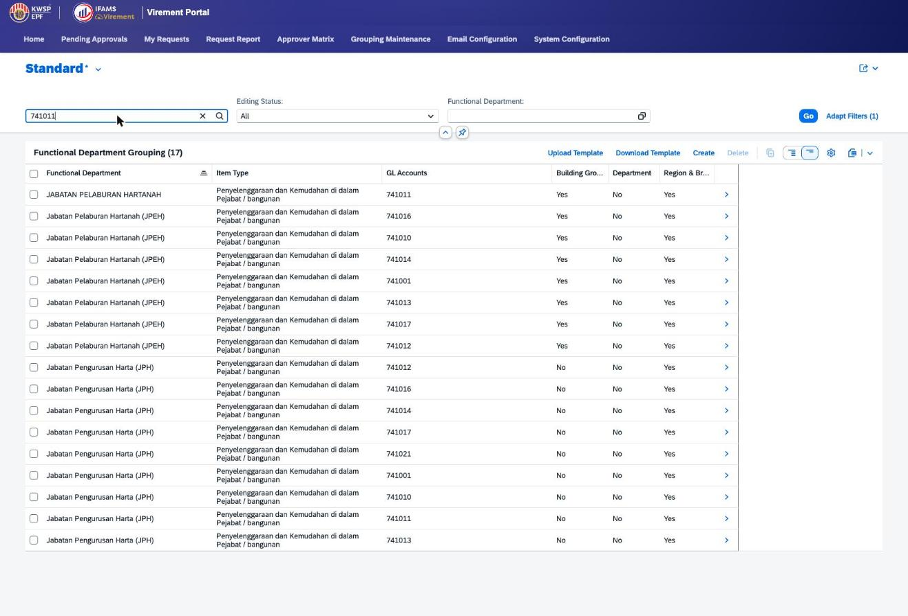

Look at the three tick columns on the right (**Building Grouping, Department, Region & Branch**). Note that GL 741011 appears under **two** departments, with **different ticks** (the Pelaburan Hartanah row has Building = Yes; the Pengurusan Harta (JPH) row has Building = No). This screenshot is from DEV. **DEV and PRD master data are not identical** — always check the environment you are actually debugging.

Two things that often catch people out in **Functional Department Grouping**:

- **One department has many rows — one per GL account — and the ticks (Building / Department / Region & Branch) can be different on each row.** The app uses the row for the line's *own* GL account. So when checking, find the row for that exact GL account, not just any row for the department.
- **The same GL account must not be listed under two different departments.** If it is, the app simply takes whichever it finds first, and the result can look random. (Example found in real data: GL 741011 appears under both JABATAN PENGURUSAN HARTA and JABATAN PELABURAN HARTANAH.)

#### Step 4 — Walk down the rule list yourself

This is the exact order the app uses. It stops at the first rule that fits. "Same X" means **every** line (both transfer-out and transfer-in) has a value for X and they are **all identical**.

| Order | Rule | It fits when… | Approver |
|---|---|---|---|
| 1 | Central Fund | Any "transfer out" line is from the Central Fund (cost centre 100050500, material 760001000) | JKEW (by amount) |
| 2 | Same cost centre | All lines have the same cost centre **and** the same GL group, and that cost centre has a department (or, failing that, a branch) | Head of Department / Head of Branch |
| 3 | Functional department | All lines belong to the same functional department, **and** each line is the right "type" for that GL's row in Functional Department Grouping (see below) | Head of Functional Department |
| 4 | Different GL group | The lines are not all in the same GL group | Cost centre heads → Head of JKEW → CEO/CFO |
| 5 | Same department | All lines in the same department | Head of Department |
| 6 | Same branch | All lines in the same branch | Head of Branch |
| 7 | Same region | All lines in the same region | Cost centre heads → Regional Director |
| 8 | Functional department (loose) | All lines in one functional department and every "transfer out" line is that department's own | Head of Functional Department |
| 9 | Last resort | Nothing above fitted | Cost centre heads → JKEW (by amount) |

*"Right type" in rule 3* means: the GL's row in Functional Department Grouping has at least one of these ticked, and the line matches it —
- **Department** ticked → the line's department is that functional department.
- **Region & Branch** ticked → the line has a region and a branch.
- **Building Grouping** ticked → the line is a building (has a Building Name).

Every "transfer in" line may match any one of the ticked types. Every "transfer out" line must be a Department line or a Building line.

Find the first rule your request *should* have matched, then use Step 2's facts to see which fact stopped it.

#### Step 5 — Confirm in the application logs (optional)

If the screen doesn't explain it, the app writes down what it saw. Open the application log in BTP (the Cloud Logging dashboard, or run `cf logs virement-srv --recent` for a quick look), filter on `virement-srv`, and search for **`virement-scenario`**:

| Log message | What it means |
|---|---|
| "Classifying scenario from items:" + a list | The exact facts the app used for each line. Compare with Step 2. If they differ from the screen, the line was saved before its facts finished filling in. |
| "Not yet classifiable - missing a transfer-out or transfer-in item" | Normal — the request is incomplete. |
| "…no Functional Department Grouping master row was found" | The functional department name on the lines no longer exists in the list (renamed or deleted). |

Also search **`apply-approver-plan`** for *"no current Approver Matrix approver was found for the role"* — the app chose the right role but nobody holds it (Step 6).

#### Step 6 — Right role, but wrong person or nobody

The rules decide the **role**. The **person** comes from **Approver Matrix** in the portal. Check that there is a row for that role **and** for the right scope (the department / branch / functional department / cost centre / region the rule picked), that it is current, and that no delegation is sending it to someone else. If a required role has nobody, the app refuses to submit the request.

#### Step 7 — Old requests are not fixed automatically

The approver list is worked out while the request is being drafted and once more when it is submitted. If you fix a list or the code afterwards, requests **already submitted** keep their old approvers. Raise a new request (or edit a draft) to see the corrected result.

#### Real example

A Virement had two lines on cost centre 10812B001, GL 741011, functional department JABATAN PENGURUSAN HARTA, Is Building = Yes. It went to a JKEW Officer instead of the Head of Functional Department.

Walking the list: rule 1 no; rule 2 no (a building cost centre has no department or branch, so it cannot use it); rule 3 — the functional department matched, but at that time the app only understood the "Department" and "Region & Branch" ticks and a building line has neither, so it failed; rules 4–8 all need a department, branch or region, which a building doesn't have; rule 9 — last resort → JKEW.

**Cause:** the "Building Grouping" tick existed on Functional Department Grouping but the routing never read it. **Fix:** routing now reads it (code: `classifyByFunctionalDepartmentGrouping` in `srv/code/utils/virement-scenario.js`, commit `7fb190a`). Checked by creating the same request as a draft on PRD and seeing Head of Functional Department in Approvers, then discarding the draft.

**Where the code lives (for developers):** rules → `srv/code/utils/virement-scenario.js`; Supplement/Return amount bands → `srv/code/utils/approver-routing.js`; turning the result into approver rows → `srv/code/utils/apply-approver-plan.js`; the facts looked up per line → `srv/code/utils/*-lookup.js`.

## 5. Submission & approval lifecycle

### Every submission-time validation — `requests-before-create-logic.js`

Runs `@Before(CREATE, Requests)`, on both first submission and later edit-saves (distinguished by `isFirstSubmission = !request.data.requestNumber`). In order:

1. **Budget Zerorise role check** — `BUDGET_ZERORISE` role required if `returnCategory === "Z"`. Every submission, not just first.
2. **Field/enum validation** — request ID, type, fiscal year present; type-specific enum checks (return category, transfer category, budget type).
3. **At least one item** exists.
4. **WBS required** for Supplement + Project on every item.
5. **Material/GL alignment** — first 6 digits of Material must match first 6 of GL Account (exempt: Central Fund cost centre).
6. **Cost Centre existence** — validated live against S/4.
7. **Transfer In/Out exclusivity** — Virement only, no single item may carry both.
8. **Item count bounds** — Virement only, 1–50 Transfer-In and 1–5 Transfer-Out items.
9. **Balance check** — Virement only, total Transfer-Out must equal total Transfer-In.
10. **Zero-amount rejection** — every submission; the relevant amount for the request's type must be non-zero.
11. **Approval-plan gap check** — first submission only; any CAP-owned level with zero current approvers hard-blocks.
12. **Same-person conflict checks** — first submission only; one person assigned to any two approval levels (L1 vs L2, L2 vs L3, etc.; lettered 1A–1E count as one level) is blocked, plus requestor-is-also-an-approver, both via `resolveApprovalPlanWithApprovers`.
13. **Project budget cap** — RM 5,000,000 on Transfer-out/Supplement total.
14. **Request number generation** — first submission only.
15. **S/4 posting simulation** — `simulatePostToS4`, `IV_TEST="X"`, first submission only; a posting-time failure is caught here, before any approver sees the request.
16. **Earmarked Funds reservation** — Virement with transfer-out amount > 0, first submission only; failure aborts the whole submission (runs Before CREATE, nothing persisted yet).
17. **Attachment required** — first submission only; at least one attachment must be present (max 5 via `@Validation.MaxItems`).

### Approve — `approve-reject-request.js`

1. Finds the caller's own Pending `RequestApprovers` row(s) and every other currently-open task, matched against the BPA workflow's open task(s).
2. **Waits for every parallel sibling** — if other lettered sub-levels (e.g. `1B`/`1C`) at the same numeric level are still Pending, the request does *not* advance yet.
3. Marks this approver's row(s) Approved; if this really was the last outstanding sibling, activates the next level's rows (`LIKE '${nextLevel}%'` — the wildcard is what activates a whole lettered family together).
4. Auto-resolves any remaining same-letter duplicate approvers as "not required to act."
5. **Only once the last configured level has genuinely closed**, and only for a Virement that has an Earmarked Funds document, **completes that document first** (it checks the live status in S/4 so a document is never completed twice). While the document is open it still holds its budget reservation, which would collide with the posting's own budget check. **If completion fails, the approval is not processed and nothing is posted**; the approver sees the S/4 message and can try again.
6. Calls `performPostToS4` in-process (no BPA round trip) — builds the FMBB payload, posts via CPI, stamps the document number, commits the DB transaction. If the posting fails here, the request stays Pending Approval while its Earmarked Funds document is already complete; the retry skips the completion.
7. Completes the BPA task *last*, after S/4 posting has already committed — a BPA-completion failure is logged but does not fail the request.

### Reject

Unconditional and terminal — no level-advancement logic. Sets the request straight to Rejected, auto-resolves every other Pending sibling at the same level as "not required to act," commits, then emails the requestor and completes the BPA task with a reject decision.

**Reject by System** (`reject-by-system-logic.js`, admin only) does the same on the system's behalf for a request stuck in Pending Approval: it rejects the pending approver rows, records the history as "System", closes any open BPA task and commits (no email).

**Earmarked Funds on rejection** — both paths then call `completeEarmarkedFundsAfterRejection` (`utils/earmarked-funds-rejection.js`) so the reserved budget is released. A rejected request cannot be reopened in the app, so nothing else would close the document.
- It runs only **after** the rejection is saved, and is **best-effort**: an S/4 failure never blocks or undoes the rejection.
- Success ("Earmarked Funds document <number> has been marked complete by System") and failure are both written to the request history (changed by "System"). On failure the person rejecting also gets a warning, and the document **needs manual follow-up** because it still holds budget.
- A document that is already complete is left alone; requests without one (Project Virement, Supplement, Return) are skipped.

## 6. S/4 & Earmarked Funds integration

### Posting — `post-to-s4-logic.js`

Calls the RFC-enabled function module **`ZFM_FI_FMBB_UPLOAD`** through the `CPI` destination, endpoint `/http/ZFM_FI_FMBB_UPLOAD`, hand-built SOAP-RFC XML in, XML parsed back out.

| Request Type | `IV_PROC` | Notes |
|---|---|---|
| Supplement | `SUPL` | — |
| Return, Zerorise | `RETN` | — |
| Return, Central Fund | `TRAN` | Funds genuinely move to a different fund centre, so it posts as a Transfer, plus a synthetic line into cost centre `100050500` / GL `760001` |
| Transfer/Virement | `TRAN` | One combined payload — transfer-out lines signed `-`, transfer-in signed `+`, in a single `IT_ITEM` array (not two documents) |

`IV_SUPL_TYPE` is simply `PROJECT` / `NONPROJ` from Budget Type.

> **simulatePostToS4** — runs the identical payload-build/validate/CPI-call path with `IV_TEST="X"` forced on every payload, no document number read, nothing persisted. Called from both `requests-before-create-logic.js` and `requests-resubmit-logic.js` so a bad Cost Centre/GL/unbalanced Transfer is caught at submission, not after the whole approval chain has run.

### Earmarked Funds — `utils/earmarked-funds.js`

A budget reservation created at *submit* time (before the FMBB posting exists) for any **Non-Project** Virement carrying a transfer-out amount — so the money can't be double-committed while the request is in flight. Skipped entirely for **Project** Virement (`requests-before-create-logic.js` gates creation on `budgetTypeCode !== 'P'`, and the `earmarkedFundsDocNumber` field is hidden in the UI for Project too): the Earmarked Funds API's account assignment is Fund Center/Commitment Item only, which doesn't apply to WBS-based items, and reusing the WBS's derived Cost Centre there would be semantically wrong. Two different backends, on purpose:

- **Create + read status** — via the `CPI` iFlow (GET/POST only).
- **Complete** — via the CPI iFlow route `/http/Z_KFM_EF_COMPLETE` (SOAP-RFC XML, same destination as posting), which calls the RFC `Z_KFM_EF_COMPLETE` (ABAP side wraps the standard `FMFR_CHANGE_COMPLETION_FLAG`, `ZKFM_EF` function group). The document number is padded to 10 characters with leading zeros (`200000048` → `0200000048`) before it is sent. `T_RETURN` messages of type `E`/`A` fail the call; the function is `completeEarmarkedFundsDocument` in `utils/earmarked-funds.js`.
- **Automatic on approval** — `approve-reject-request.js` completes the document **before** posting the Transfer. A failure **blocks the approval** (nothing is posted); see §5.
- **Automatic on rejection** — both reject paths complete it **after** the rejection is saved, best-effort; see §5 "Reject". For rejections made **before this was added**, or where it failed, an admin uses the button below.
- **Completion flag on the Object Page** (`requests-after-read-logic.js`) — Completed requests show it as complete; **Rejected** requests are checked live against S/4; all others show not complete.
- **Admin button "Complete Earmarked Funds"** (`completeRejectedEarmarkedFunds`, `complete-rejected-earmarked-funds-logic.js`) — in bulk on **Request Report** (admins tick the Rejected requests; the button is enabled only when **every** selected row is a **Virement** with status **Rejected**; `webapp/ext/controller/VirementRequestsListReportActions.js` runs them one at a time and confirms each against S/4; the list loads rows as you scroll, so scroll to load them all before *Select All*), and on the request page, shown only to **admins**, only on a **Rejected Virement** that has an Earmarked Funds document which is not yet complete. It asks for confirmation, completes the document (never twice) and records "Earmarked Funds document <number> has been marked complete by System" in the request history. The admin who clicked is recorded in the application log (`complete-rejected-earmarked-funds-logic`, `triggeredBy`). The role and status rules are enforced on the server, not just by hiding the button.
- **Manual retry is hidden** — `retryEarmarkedFundsCompletion` still exists as an action, but its UI button is unconditionally `UI.Hidden` in `annotations.cds`. Restore the condition there to bring it back.

### Live S/4 value helps

| Field | Service path |
|---|---|
| Cost Centre | `/sap/opu/odata/sap/API_COSTCENTER_SRV/A_CostCenter` |
| GL Account | `/sap/opu/odata/sap/ZFGL_GW_JV_VALUEHELP_O2/GLAccountVH` |
| Material Group | `/sap/opu/odata/sap/ZFGL_GW_JV_VALUEHELP_O2/MaterialGroupVH` |
| WBS Element | `/sap/opu/odata/sap/ZFGL_GW_JV_VALUEHELP_O2/WBSElementVH` — a purpose-built custom value help, not a standard SAP API, see §11 |

All four go through `QA1-800-S4HANA` and share `srv/code/utils/value-help.js`'s fetch/narrow helpers, which re-rank S/4's fuzzy `search=` results against exactly what the user typed.

## 7. SAP Build workflow integration

One workflow instance per request lifecycle (not per level), started synchronously inside the submit transaction by `startApprovalWorkflow` (`utils/workflow-utils.js`) — POST to `sap_process_automation_service`, definition `virementapprovalworkflowv2.approvalWorkflow`. The context payload carries request identifiers, up to 5 transfer-in cost-centre/GL slots, and — critically — `approvallevel1/2/3` (+ lettered `1a..1e`) **pre-populated from the CAP-owned plan**, so BPA receives already-resolved approver emails for CAP-owned combinations instead of looking them up itself.

### Status tracking is polling, not a webhook

There is no inbound callback from BPA. `requests-after-read-logic.js`'s `refreshLiveWorkflowStatus` polls the instance status on every Object Page read (skipped once terminal), writing back to `workflowStatus`/`workflowError`. Task IDs are looked up live on every Approve/Reject (`getOpenTaskForWorkflowInstance`) rather than stored, so the app can discover the right task without BPA proactively reporting it.

### `getApprovers` / `assignApprovers` and the fully-qualified-path workaround

`getApprovers(userRole, departmentBranch)` is a read-only OData function SAP Build calls back to resolve the current Approver Matrix holder for a role — see `get-approvers-logic.js`. A sibling, `getRequestApprovers`, lets BPA read back approvers CAP has already assigned, bypassing its own decision table for migrated combinations.

> **Confirmed SAP Build connector bug.** Both SAP Build's own Actions-catalog Test tool and a live Process Automation Service Task send unbound actions/functions at the **fully qualified** path — `POST .../ZSVC_PPS_VIREMENT.assignApprovers` instead of the OData-correct `POST .../assignApprovers` — even though the Test tool's own UI *displays* the correct path. `srv/server.js` registers Express route-workaround handlers for this at bootstrap. **Any new unbound action or function called from SAP Build must be added to `ACTIONS_REQUIRING_WORKAROUND` / `FUNCTIONS_REQUIRING_WORKAROUND` in that file**, or SAP Build will 404 against it silently from the workflow side while the Test tool appears to work.

### Task completion

BPA's native Approval Form has no custom output fields, so it cannot carry approver identity/comments back into the workflow. All business logic (approver rows, S/4 posting, Earmarked Funds) happens in CAP first; `completeTask` is called *only* afterward, purely to close the BPA task and advance the workflow branch. If S/4 posting fails, the task is deliberately left open for retry.

### Delegation and BPA task recipients

This app's own `RequestApprovers.emailAddress` is always the source of truth for who can act via its own Approve/Reject/Delegate buttons — the BPA-side sync below is best-effort and never blocks or reverses a delegation that already committed locally.

- **`delegateApproval`** (`delegate-approval-logic.js`) — self-service: the current pending approver hands off their own pending row(s) to someone else.
- **`delegatePendingApproval`** (`delegate-pending-approval-logic.js`), bound to `RequestApprovers`, `@requires: ['ADMIN']` — lets an admin reassign one specific pending assignment from the Approver Matrix Object Page's Pending Approvals facet, without being the approver themselves. Bound-action deep paths matter here: invoked via `ApproverMatrix(ID=...)/PendingApprovals(ID=...)/delegatePendingApproval`, `request.params` holds one entry **per path segment** — the bound entity's own key is always the **last** element (`params[params.length - 1]`), not `params[0]`.
- **`delegateApprovalAsAdmin`** (`delegate-approval-as-admin-logic.js`), bound to `Requests`, `@requires: ['ADMIN']` — delegates every currently-pending approval on a request in one action, from the Requests Object Page itself. Currently wired but its UI button is unconditionally `UI.Hidden` in `annotations.cds` (not in active use).

All three, after committing their own change, best-effort swap the delegate in for the original approver on the matching SAP Build task's `recipientUsers` (`addTaskRecipient` in `utils/workflow-utils.js`) — the delegating approver is removed, any *other* recipient already on the task (e.g. a different approver at the same level) is left untouched. Per the Workflow Runtime API spec (`SPA_Workflow_Runtime.json`), `recipientUsers` is a JSON array on a `TaskInstance` GET but a **comma-separated string** on the `PATCH /v1/task-instances/{id}` payload — `addTaskRecipient` normalizes between the two. Setting it also requires the calling destination credential to hold `ProcessAutomationAdmin` (or already be a recipient) — missing that fails with a 403, logged only, never surfaced as a failure of the delegation itself.

## 8. Authorization model

Authorization is plain XSUAA role collections, defined in `xs-security.json`, granted entirely from BTP Cockpit → Security → Role Collections:

| Role | Gates |
|---|---|
| `REQUEST_APPROVE` | Approve/Reject/Delegate/PostToS4 actions — declarative `@requires` in `service.cds` |
| `ADMIN` | Admin-only entities/actions (`EmailConfiguration`, `SystemConfiguration`, `delegatePendingApproval`, etc.) — declarative `@requires`/`restrict`, plus front-end-only tab/tile hiding (below) |
| `MASS_UPLOAD_TRANSFER` | Which columns a bulk item-upload template exposes — `hasRole` in code, never at the CDS transport-authorization layer |
| `MASS_UPLOAD_ALL` | Same, broader column set — `hasRole` in code |
| `BUDGET_ZERORISE` | Raising a Budget Zerorise Return — `hasRole` in `requests-before-create-logic.js` and `requests-resubmit-logic.js` |

To check any role in code: `hasRole(user, roleName)` from `srv/code/utils/role-check.js`. For a whole-action gate instead, use CDS `@requires: ['RoleName']` in `srv/service.cds`.

> **AMS/IAS policy-based authorization has been removed from this app** (`ams/dcl/` deleted, `@sap/ams`/`@sap/ams-dev` removed from `package.json`, the already-disabled `virement-ams-policies-deployer` module deleted from `mta.yaml` rather than left commented out). It had never been wired into any live authorization check — `IdentityServiceAuthProvider` was never configured, so the DCL policies it deployed were enforced nowhere; all real authorization has always been the XSUAA checks above. **Operational gap left by this removal**: `MASS_UPLOAD_TRANSFER`, `MASS_UPLOAD_ALL`, and `BUDGET_ZERORISE` previously existed *only* as AMS policy targets (IAS groups `cap - VR_FUNCTIONAL`/`VR_JKEW`/`VR_BCM`), with no XSUAA role-collection counterpart — so on any subaccount where those IAS groups haven't already been manually assigned (in particular a fresh deploy, e.g. PRD), nobody can currently be granted these three roles until a replacement is set up (the obvious options: add them to `xs-security.json` as ordinary XSUAA scopes/role collections, or reinstate a policy mechanism). `REQUEST_APPROVE`/`ADMIN` are unaffected — they were always plain XSUAA.

### Admin-only UI visibility

`UserDetails.isAdmin` (`srv/code/user-details-read-logic.js`, `hasRole(user, "ADMIN")`) drives a front-end-only visibility layer — independent of the backend `@requires`/`restrict` gates above, which remain the real enforcement. `Main.controller.js`'s `ADMIN_ONLY_NAV_KEYS` hides the Approver Matrix / Grouping Maintenance / Email Configuration / System Configuration nav tabs (and `Home.controller.js` hides their dashboard tiles) for a non-admin, so a regular requestor/approver never sees an entry point into a screen they either can't use or — for System Configuration — can't even read.

## 9. Fiori Elements app structure

`app/virement.zui_pps_virement/webapp/manifest.json` — single OData V4 service, root shell `ext.view.Main` (side-menu `NavContainer`).

### Routes

- **Home** — custom dashboard (pending count, recent requests)
- **VirementRequests / PendingApprovals / MyRequests** — three List Report views over the same `/Requests` entity set, differing only by `SelectionPresentationVariant` filter; Pending Approvals adds mass Approve/Reject toolbar actions
- **RequestsObjectPage** — the main form; 5 `RequestItems` line-item facets (SupplementItems / ReturnItems / TransferInOutItems / TransferFunctional / TransferJKEW), each with its own Upload/Download Template toolbar actions
- **GroupingMaintenance** — a menu hub linking to the 6 admin List Reports (5 Groupings + Approver Matrix)

### Item-list default view

All 5 `RequestItems` LineItem qualifiers live in `annotations.cds`: SR No first, then Cost Centre/GL Account/Material with their description fields inline, then the type-appropriate amount field(s), then Description. The routing/derived fields (Is Department, Department, Is Region & Branch, Region, Branch, GL Group, Functional Department, Is Building, Building Name) are present but marked `UI.Importance: #Low` — available via column personalization, hidden by default. Asset Status is conditionally `UI.Hidden` per row when `assetType = 'NON ASSET'`.

### Controller extensions — `webapp/ext/controller/`

| File | Role |
|---|---|
| `ObjectPageExt.controller.js` | Global ObjectPage extension — workflow-status formatters, Return Category radio write-back, workflow-error popover |
| `ObjectPageCustomActions.js` | RequestItems table toolbar — bound download/upload-items actions, draft-scoped row creation, per-row OData error mapping |
| `PendingApprovalsListReportActions.js` | Mass Approve/Reject — sequential (not parallel) to avoid overloading the S/4 connection |
| 6× `*GroupingListReportActions.js` / `ApproverMatrixListReportActions.js` | Near-identical download/upload pattern per master-data entity — see §10 |

## 10. Master-data maintenance pattern

Six admin-maintained entities (5 Groupings + Approver Matrix) each get an identical, independently-implemented five-file set — **not** a shared generic handler, deliberately duplicated per entity:

1. `download-<entity>-template-logic.js` — `@requires: ['ADMIN']` action returning a base64 XLSX built via `utils/<entity>-template.js`'s column list
2. `upload-<entity>-logic.js` — `@requires: ['ADMIN']`, parses the uploaded workbook, validates every row (required fields, formats, cross-lookups), returns `{rows: validRows}` — **does not write to the DB itself**
3. `webapp/ext/controller/<Entity>ListReportActions.js` — triggers the browser download; on upload, takes the validated rows back from the server and creates them client-side via a draft-enabled OData list binding + `draftActivate` per row
4. `webapp/ext/fragment/<Entity>UploadDialog.fragment.xml` — the FileUploader dialog
5. `utils/<entity>-template.js` — the column key/header/example/width list shared by download and upload header-matching

Errors are capped at 20 rows shown, with a rollup count beyond that, and reject the whole batch — nothing partial is ever created. **Canonical example to copy from**: `upload-approver-matrix-logic.js` is the most heavily documented of the six.

## 11. Known gotchas & hard-won lessons

**`${...}` vs `%{...}` in manifest.json / fragment expression bindings.** A manifest-declared table action's `visible`/`enabled` using `{= ${status_code} === 0 }` silently evaluated to its default (`true`) instead of reading the property — no console error. The fix, already used elsewhere in the codebase (`ObjectPageExt.controller.js` header comment) and confirmed against an official SAP sample: use `%{...}`, not `${...}`, in any expression binding inside a Fiori Elements manifest.json action or XML fragment — `${...}` gets consumed by the XML preprocessor before it reaches the control. If a condition you wrote there seems to be ignored with zero errors, check this first.

**A custom form-field fragment must render exactly one root control.** Adding a second top-level sibling control to `ReturnCategoryField.fragment.xml` (alongside the existing RadioButtonGroup) made both controls disappear with no error, for every Budget Type. Fiori Elements custom field templates expect a single control — wrap multiples in one `VBox`.

**WBS S/4 service path.** Three services were tried before landing on the current one (`srv/code/utils/wbs-elements.js`): `API_WBSELEMENT_SRV/A_WBSElement` worked but has no Cost Center field at all; `API_ENTERPRISE_PROJECT_SRV/A_EnterpriseProjectElement` has `ResponsibleCostCenter` but returned a clean 200 with 0 rows for every query (the destination's technical user most likely isn't authorized for Enterprise Project data); the working path is now a **purpose-built custom value help**, `/sap/opu/odata/sap/ZFGL_GW_JV_VALUEHELP_O2/WBSElementVH` (fields `WBSElement,WBSDescription,ResponsibleCostCenter`), confirmed against a live sample response. It also has a live data-quality quirk: it occasionally returns a row with a blank `WBSElement` key alongside a real description (e.g. `{"WBSElement":"","WBSDescription":"INSTL. PAPANTANDA","ResponsibleCostCenter":""}`) — `readWBSElements` filters these out defensively, since a blank key breaks the value-help dialog's row binding.

**SAP Build's fully-qualified-path bug.** See §7 — any new unbound action/function called by a workflow needs registering in `srv/server.js`'s workaround lists, or it will silently fail from the workflow side while SAP Build's own Test tool appears to work fine.

**Attachments text tables need a base HDI file (deploy failure).** `@cap-js/attachments` ships per-language `sap.attachments-ScanStates_texts_<lang>.csv` files, but `cds build` does not emit the base `sap.attachments-ScanStates_texts.hdbtabledata`, and the HANA deployer fails with `include_filter ... not disjunct` / `defines no include_filters`. The srv build in `mta.yaml` copies the base CSV and `db/hdi-overrides/sap.attachments-ScanStates_texts.hdbtabledata` (filter `__none__`, so it imports nothing) into `gen/db/src/gen/data/`. Upgrading `@cap-js/attachments` to 3.13.3 did not remove the need for this.

**Debugging `ZFM_FI_FMBB_UPLOAD` (or any RFC-invoked S/4 function) — set an External Breakpoint, not a normal one.** This function is called via RFC from the `CPI` destination (see §6), not from a dialog session — a plain Session Breakpoint set in your own SAPGUI logon will never trigger for it, even though the code genuinely executes (confirmed by matching the exact `ET_RETURN` message text back to the ABAP source). In the Q (QA1) S/4 backend, set an **External Breakpoint** instead — Utilities → Breakpoints → External Breakpoints in the ABAP editor/debugger, tied to user ID `PWC_RAY` — before triggering the request submission from the app.

**IAS SCIM `costCenter` is frequently blank; `department` is not.** `srv/code/utils/ias-user-directory.js`'s `fetchUserDepartment` reads a user's own Department/Section from the IAS Identity Directory's SCIM Enterprise User extension (`urn:ietf:params:scim:schemas:extension:enterprise:2.0:User`) rather than from the login token — confirmed live that this app's actual JWT always carries an empty `xs.user.attributes`, regardless of the IAS Application's Self-defined Attributes config, because the SaaS approuter's XSUAA `user_token` exchange doesn't carry custom IAS profile attributes through. Within that SCIM extension, `costCenter` and `department` are sibling attributes; `costCenter` comes back empty for many employees in the IAS Admin Console while `department` is reliably populated, so this field reads `department`, not `costCenter`, despite the similar field name on `Requests.departmentSection`.

### Debugging the backend (CAP service)

The "backend" is the **CAP service** — a Node.js app deployed as `virement-srv`. Every business rule lives in `srv/code/*.js`, hooked up in `srv/service.js` with `this.before(...)`, `this.after(...)` and `this.on(...)`. Debugging it means three things: **find which handler ran**, **read what it logged**, and **step through it** if the log is not enough.

**Two things to know first**
- A request has two lives. While the user is editing, it is a **draft** (handlers registered on `Requests.drafts` / `RequestItems.drafts`). Pressing **Submit** *activates* it (handlers on `Requests`, e.g. `requests-before-create-logic.js`). A bug that "only happens on submit" is in the second set; one that "happens as I type" is in the first.
- Almost every message the user sees on a failed save comes from `request.error(...)` in one of those files, so **the message text is searchable** (see Step 1).

#### Step 1 — Find the code that ran

Search the source for the exact words of the error message the user saw: `grep -rn "part of the message" srv/`. If there is no message, use this map:

| What went wrong | Open this file |
|---|---|
| An item field (department, GL group, description…) is blank or wrong | `requestitems-drafts-before-create-logic.js` / `requestitems-drafts-before-update-logic.js`, then the matching `utils/*-lookup.js` |
| Wrong approver or wrong level | `utils/virement-scenario.js`, `utils/approver-routing.js`, `utils/apply-approver-plan.js` — see "Debugging a wrong approver" in §4 |
| Person missing for a role | `get-approvers-logic.js` and the Approver Matrix data |
| Submit is blocked with a message | `requests-before-create-logic.js` (one function per rule, §5) |
| Totals / amounts wrong | `requests-calculateValues-logic.js`, `requests-drafts-calculateValues-logic.js`, `utils/requests-calculation-utils.js` |
| Approve / Reject / Delegate | `approve-reject-request.js`, `delegate-*-logic.js` |
| Posting to S/4 fails | `post-to-s4-logic.js` (`buildPayloads`, `simulatePostToS4`) |
| Earmarked Funds problem | `utils/earmarked-funds.js`; after a rejection also `utils/earmarked-funds-rejection.js` |
| Workflow does not start or finish | `utils/workflow-utils.js`, and the fully-qualified-path workaround in `srv/server.js` (§7) |
| Email not sent or wrong text | `utils/send-email.js`, `utils/email-config-renderer.js` |
| Value help (cost centre, GL, material, WBS) empty | `*-read-logic.js` and `utils/value-help.js` |
| Template upload rejects rows | `upload-<entity>-logic.js` |
| "Not authorised" / 403 | `srv/service.cds` `@requires` / `@restrict`, `utils/role-check.js`, and the user's role collections (§8) |

#### Step 2 — Read the error the client received

Open the browser's Developer Tools → **Network**, repeat the action, click the red request and read **Response**. CAP answers errors as JSON: `{"error":{"code":"…","message":"…","target":"…"}}`.
- **400** — a rule the code enforces on purpose (`request.error`). The message tells you which rule.
- **401 / 403** — login or permissions, not a code bug.
- **404** — wrong path or an id that no longer exists (a discarded draft returns "Not Found").
- **500** — something unexpected threw. Go to the logs for the stack trace.

This is what a CAP error looks like. A validation error (400) has the same shape, with the rule's text in `message`:

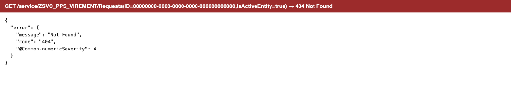

#### Step 3 — Read the logs

Every module writes to a named logger (`cds.log("<name>")`), and the name is the file name, so you can search by it. Useful ones:

| Logger | Tells you |
|---|---|
| `request-user` | **Who** did **what**: every non-READ call (create / update / action) with the user id and entity. Start here to find the moment a request was touched. |
| `virement-scenario` | Which routing rule fired and the exact item facts it used |
| `apply-approver-plan`, `get-approvers-logic` | Which approvers were resolved, and warnings when a role has nobody |
| `requests-before-create-logic` | Submission validations |
| `post-to-s4-logic` | Payload and result of the S/4 posting (and the simulation) |
| `earmarked-funds` | Earmarked Funds create / complete calls |
| `earmarked-funds-rejection` | A rejected request whose Earmarked Funds document could not be completed (needs manual follow-up) |
| `workflow-utils` | Calls to SAP Build Process Automation |
| `send-email`, `email-config-renderer` | Notification emails |
| `ias-user-directory` | The requestor's department lookup from IAS |
| `system-config` | Which destination names / workflow ids are in use |

Where to read them:
- **Live while you reproduce:** `cf logs virement-srv` (leave it running, then repeat the action).
- **Recent history:** `cf logs virement-srv --recent` (the last few hundred lines only).
- **Searchable history:** the Cloud Logging dashboard (the `shared-logs` service bound to the app). Filter `component_name: virement-srv`, then search the logger name or the request number.

#### Step 4 — Turn up the detail (debug level)

By default only `info`, `warn` and `error` lines appear. To see `debug` lines for one module, or the SQL CAP sends to the database, raise the level with the `CDS_LOG_LEVELS` setting (checked against the installed CAP version, 9.x):

| Where | Command |
|---|---|
| Local | `CDS_LOG_LEVELS='{"virement-scenario":"debug"}' cds watch` (JSON form — needed because logger names contain hyphens) |
| Local, SQL | `CDS_LOG_LEVELS_SQL=debug cds watch` |
| BTP (DEV) | `cf set-env virement-srv CDS_LOG_LEVELS '{"sql":"debug"}'` then `cf restart virement-srv` |
| BTP, switch back | `cf unset-env virement-srv CDS_LOG_LEVELS` then `cf restart virement-srv` |

When running locally, add `CDS_REQUIRES_DB_KIND=sqlite` to these commands too (see Step 5).

> **Do not leave debug on, and do not use SQL debug on PRD.** It writes real business data (amounts, emails) into the logs.

#### Step 5 — Run it locally and step through the code

This is the fastest way to find a logic bug, because you can set a breakpoint.

1. `npm install`, then start it **with the SQLite override**: `CDS_REQUIRES_DB_KIND=sqlite npx cds watch`. It serves at `http://localhost:4004`, restarts when you save a file, and uses an in-memory SQLite database loaded from the seed files in `db/data/`.

   > **Why the override:** on a machine where `cds bind` has been run (the git-ignored `.cdsrc-private.json` exists), plain `cds watch` — and `npm run start-local`, which runs it — tries to connect to HANA and stops with *Database kind "hana" configured, but no HDI container or Service Manager instance bound*. Forcing `sqlite` avoids that. (Tested with CAP 9.9.)

   A healthy start prints these lines (the port may differ):

   ```
   [cds] - connect to db > sqlite { url: 'db.sqlite' }
   [cds] - using auth strategy { kind: 'mocked' }
   [cds] - serving ZSVC_PPS_VIREMENT { at: [ '/service/ZSVC_PPS_VIREMENT' ], impl: 'srv/service.js' }
   [cds] - server listening on { url: 'http://localhost:4004' }
   ```

   Open `http://localhost:4004/` — the project preview page lists the service and its entities:

   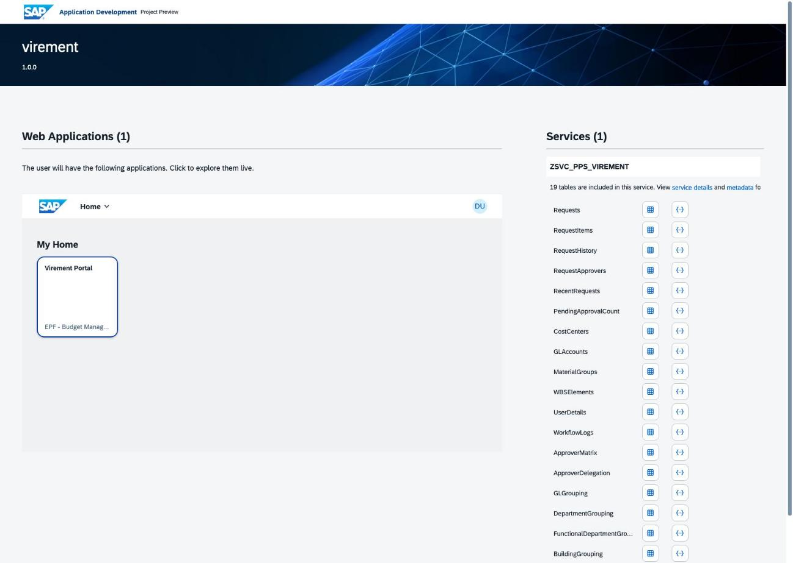

2. Sign in with one of the **mocked users** defined under `cds.requires` → `[development]` → `auth` in `package.json` (they carry the roles you need, e.g. approver and admin). Locally there is no XSUAA/IAS.
3. **Set a breakpoint:** in VS Code open a *JavaScript Debug Terminal*, run the Step 5 command (`CDS_REQUIRES_DB_KIND=sqlite npx cds watch`) there, click in the gutter beside a line (for example the start of `classifyVirementNonProjectScenario` in `utils/virement-scenario.js`), then repeat the action in the browser. Execution stops at the breakpoint and you can inspect the variables. (Without VS Code: `CDS_REQUIRES_DB_KIND=sqlite node --inspect ./node_modules/.bin/cds-serve`, then attach any Node debugger to port 9229.)
4. **What does not work locally:** anything that calls out — S/4 value helps and posting (CPI), SAP Build workflow, IAS directory, Earmarked Funds. Those need real destinations. Use the **hybrid** profile (`cds watch --profile hybrid`, configured in the git-ignored `.cdsrc-private.json`) after `cf login` and `cds bind`, which connects the local app to the bound cloud services. Without that, expect those parts to fail with connection errors that say nothing about your change.

#### Step 6 — Call the API without the UI

Faster than clicking through the app, and it separates "backend bug" from "screen bug". The service root is `/service/ZSVC_PPS_VIREMENT/` (locally `http://localhost:4004/service/ZSVC_PPS_VIREMENT/`).
- `…/$metadata` lists every entity, field and action.
- `…/Requests?$top=5` reads requests. A **draft** is addressed with `IsActiveEntity=false`, e.g. `…/Requests(ID=<uuid>,IsActiveEntity=false)`.
- Actions are `POST`s, e.g. `…/Requests(ID=<uuid>,IsActiveEntity=true)/ZSVC_PPS_VIREMENT.approveRequest`.
- Use any HTTP client (Postman, curl, VS Code REST client). Locally, send the mocked user as Basic auth — without it the service answers `401`.

Example: reading one request from the DEV service (email addresses and internal values masked). Note the fields beyond the database columns, such as `isAdmin` and `HasDraftEntity`, which are the virtual flags described in the data model:

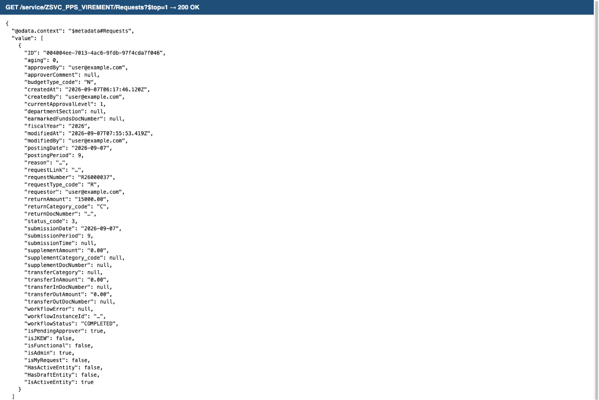

#### Step 7 — Look at the data

Open **SAP HANA Database Explorer** on the `virement-db` HDI container. Real tables are `ZDB_PPS_VIREMENT_<ENTITY>` (e.g. `ZDB_PPS_VIREMENT_REQUESTS`); the service views are `ZSVC_PPS_VIREMENT_<ENTITY>`; **drafts live in separate tables** named `ZSVC_PPS_VIREMENT_<ENTITY>_DRAFTS`. A value that looks right in the UI but is missing after submit is often still sitting in the draft table. Table and field meanings are in §3 (data model).

#### Step 8 — When the problem is in another system

The app calls out to S/4 (value helps), CPI (posting, Earmarked Funds), SAP Build Process Automation (workflow) and IAS (user department). The destination names are on the **System Configuration** admin page, which also has a **test** action per setting (`test-connection-logic.js`) that reads one harmless row to prove the destination works. If a test fails, the problem is the destination, credentials or network — not the app code. For the S/4 side of a posting, set an **External Breakpoint** (see the gotcha earlier in this section).

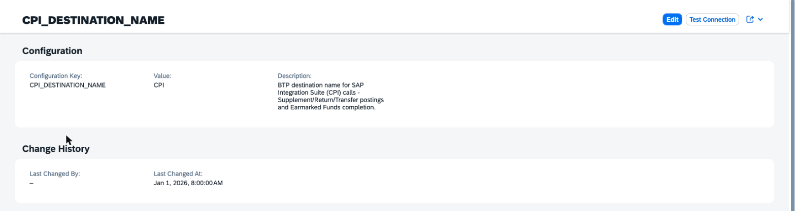

#### Step 9 — Debug a running DEV instance (advanced)

If a problem only happens on BTP and you cannot reproduce it locally, you can attach to the deployed app. **DEV only — never PRD**, and your organisation may not allow SSH:
1. `cf enable-ssh virement-srv`, then `cf restart virement-srv`.
2. `cf ssh virement-srv`, and inside it `pkill -USR1 -f node` to start Node's inspector (port 9229).
3. From your laptop: `cf ssh -N -L 9229:127.0.0.1:9229 virement-srv`, then attach VS Code (*Attach to Node Process*, `localhost:9229`).
4. When done: `cf disable-ssh virement-srv` and restart.

#### Quick symptom table

| Symptom | Most likely cause | First thing to check |
|---|---|---|
| Works for you, "not authorised" for a colleague | Missing role collection | BTP Cockpit role collections (§8) |
| Approvers differ between the draft and after submit | Item facts changed, or master data edited in between | `virement-scenario` log lines for both moments |
| Posting says "document not posted" after approval | S/4 rejected the payload | `post-to-s4-logic` log; the simulation at submit would have caught most cases |
| Workflow never starts | Wrong workflow id/destination, or SAP Build path bug | System Configuration test; `srv/server.js` workaround list (§7) |
| Field blank only on uploaded rows | Uploaded rows fill their derived fields through `utils/request-item-enrichment.js`, not the per-item handlers — a new derived field must be added in **both** places | `requests-drafts-upload-items-logic.js`, `utils/request-item-enrichment.js` |
| Change works locally, not on BTP | Different master data / destinations | Compare Grouping and System Configuration between environments |

## 12. Build & deploy process

1. Confirm the right target: `cf target` — should show the correct org/space. If it shows an unrelated org, re-run `cf login`.
2. `mbt build` from the repo root — produces `mta_archives/virement_1.0.0.mtar`.
3. `cf deploy mta_archives/virement_1.0.0.mtar` — deploys all 6 modules.
4. A CF session can expire mid-deploy on a long-running deploy — if you see "Authentication has expired," re-run `cf login` and simply re-run the same `cf deploy` command; the built `.mtar` is still valid.

> Compile-check any CDS change before building: `npx cds compile db/schema.cds srv/service.cds app/virement.zui_pps_virement/annotations.cds --to edmx`. One pre-existing, harmless warning always appears (`NonUpdateableProperties` on `Requests_RequestAttachments`, from the `@cap-js/attachments` library's own annotation) — anything beyond that line is a real problem.

## 13. Admin configuration pages (Email & System Configuration)

Two draft-enabled, admin-maintained entities let an admin change behaviour without a code change or redeploy. Both follow the same List Report + Object Page pattern as the Grouping entities (§10), but are single-purpose (fixed seeded rows, never created/deleted — `Capabilities.InsertRestrictions`/`DeleteRestrictions` both `false`).

### Email Configuration

`EmailConfiguration` (`db/schema.cds`) — one row per notification (`ToApprover`/`Approved`/`Rejected`), each with an editable `subject`/`body` (HTML) and an `enabled` switch. READ is open to any authenticated user; UPDATE and the `testSendEmail` action are `ADMIN`-only (`srv/service.cds`'s `restrict`).

- `srv/code/utils/email-config-renderer.js` — `renderEmailConfig(tx, emailType, data, opts)` substitutes `{{Placeholder}}` tokens (`RequestNumber`, `RequestLink`, `RejectionReason`, `ItemsTable`, etc. — see `utils/approval-email-context.js`/`approval-email-templates.js`) against the row's current `subject`/`body`.
- `srv/code/utils/send-email.js` — `sendEmail({subject, body, recipients, cc})` posts to the S/4 custom Email OData v4 service (`ZSB_SCA_EMAIL_O4`) via the `S4_DESTINATION_NAME` destination (CSRF-token fetched from the service root, not the action path), `IsHtml: true`. Never throws — a failed send is logged and does not block the approval/rejection it's attached to.
- `srv/code/test-send-email-logic.js` — the `testSendEmail` action, bound to one `EmailConfiguration` row: renders that row's current template against sample data (ignoring its `enabled` switch) and sends it to an admin-given recipient, so a template edit can be verified before it goes out for real.

> **CDS `@(restrict: [...])` is an allowlist for custom actions too.** `testSendEmail` needed its own entry in the `grant` array (`grant: ['UPDATE', 'testSendEmail']`) — a separate `@requires: ['ADMIN']` on the action declaration alone is not enough; without the grant entry it 403s regardless of the caller's role.

### System Configuration

`SystemConfiguration` (`db/schema.cds`) — `configKey`/`configValue`/`description` rows (5 seeded: `WORKFLOW_DEFINITION_ID`, `WORKFLOW_ENVIRONMENT_ID`, `S4_DESTINATION_NAME`, `CPI_DESTINATION_NAME`, `BPA_DESTINATION_NAME`), overriding the hardcoded defaults described in §2. Unlike Email Configuration, **both READ and UPDATE are `ADMIN`-only** — these values describe internal destination/workflow wiring, not something a regular user needs visibility into.

- `srv/code/utils/system-config.js` — `getConfigValue(key, fallbackDefault)` is the single read path every caller uses (`workflow-utils.js`, `send-email.js`, `cost-centers.js`, `value-help.js`, `post-to-s4-logic.js`, `earmarked-funds.js`): looks up the row, falls back to the hardcoded default if missing or on any read failure (never throws), and caches all rows for 5 minutes in-process. `invalidateCache()` is called from an `after("UPDATE", "SystemConfiguration", ...)` hook in `srv/service.js` so a saved edit takes effect immediately rather than waiting out the TTL.
- **Deliberately excluded**: `IAS_SCIM_CLIENT_ID`/`IAS_SCIM_CLIENT_SECRET` (see §11) are never stored here or anywhere DB-readable — they stay `cf set-env` environment variables only. This table is for non-secret configuration exclusively.
- Seed CSV (`db/data/ZDB_PPS_VIREMENT-SystemConfiguration.csv`) carries fixed `createdAt`/`modifiedAt` timestamps — without them the row has no `@odata.etag` value, and Edit mode fails with "Precondition Required" (same bug class as any CSV-seeded, `managed`-aspect, draft-enabled entity — see `EmailConfiguration`'s seed for the same fix).
- This is the mechanism to use ahead of a new subaccount deploy (e.g. PRD): update the row for whichever destination/workflow ID differs there, rather than editing a hardcoded constant and redeploying.

> **A parameter-less `UI.DataFieldForAction` button needs its result pushed as a CAP message, not just returned.** Fiori Elements only displays an action's result if it arrives via the OData message protocol (`request.info(msg)` on success, `request.error(status, msg)` on failure) — a plain `return msg;` is silently never shown, even though the call succeeded. Confirmed via `testConnection` returning 200 with nothing on screen until `request.info(message)` was added alongside the `return`. Separately — and specific to this app's custom root view (`ext/view/Main.view.xml`'s `sap.tnt.ToolPage` wrapping an inner `sap.m.App#appContent`) — `sap.fe`'s own message-popover goes looking for the current page via `AppComponent.getRootContainer().getCurrentPage()`, which resolves to the `ToolPage` (no `getCurrentPage` method) and throws, unless `Component.js` overrides `getRootContainer()` to return `byId("appContent")` instead. Both fixes are needed together for any action-returned message to actually display; see `test-connection-logic.js` and `webapp/Component.js`.

## License

Internal — Employees Provident Fund (EPF).

---

Done by **Ray**.
